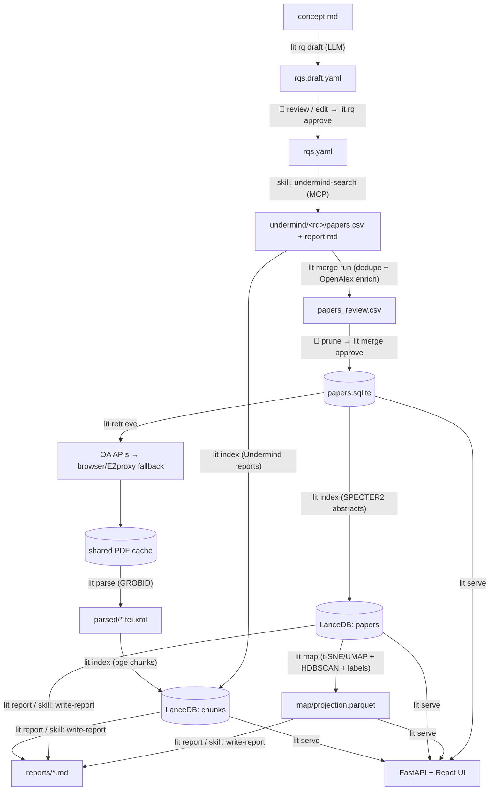

# LiteratureReviewCreator — Architecture

A pipeline that turns a **concept note** into a complete, queryable **literature knowledge base** (KB),
a holistic cited report, and an interactive map of the literature.

Status: **implemented**: CLI stages 0–9, API, skills and the React frontend (mocked unit tests on both sides,
plus a live run on a 148-paper OpenAlex demo project).

---

## 1. Decision log

| # | Area | Decision | Notes |
|---|------|----------|-------|
| D1 | Orchestration | **Hybrid**: Python package (`litkb`, CLI `lit`) for deterministic work; **Claude Code skills** for judgment-heavy steps | Skills live in `.claude/skills/` and call the CLI |
| D2 | LLM | **Pluggable provider** interface; default **OpenRouter** with `google/gemini-4-hydrogen` | Model set in `.env` (`LITKB_MODEL`, optional `LITKB_MODEL_SYNTHESIS` / `LITKB_MODEL_FAST`); Anthropic-direct and OpenAI-compatible (Ollama / LM Studio) kept as alternatives via `LITKB_PROVIDER` |
| D3 | Undermind | **Undermind MCP connector**, driven by a Claude Code skill | One deep search per RQ; the skill writes `.csv` + `.md` + `meta.json` per RQ (see §5.2) |
| D4 | Human-in-the-loop | Checkpoints after **RQ generation** and after **paper-list merge** | Everything else automatic |
| D5 | OA sources | Unpaywall + OpenAlex → Semantic Scholar → arXiv / bioRxiv / medRxiv | Tried in that order per paper. **No CORE** (no API key) |
| D6 | Paywall | **Playwright persistent browser profile**; user logs in via university SSO/EZproxy once | Password never stored; rate-limited; last resort after OA |
| D7 | PDF parsing | **GROBID** (Docker) → TEI XML | Sections, references, captions |
| D8 | Metadata DB | **SQLite**, one file per project | |
| D9 | Vector store | **LanceDB** (embedded) | Hybrid vector + BM25 search, metadata filters |
| D10 | Embeddings | **SPECTER2** for paper-level abstracts (map, paper similarity); **bge** for full-text chunks | Local, CPU (no GPU); model names configurable |
| D11 | Chunking | **Section-aware** from GROBID TEI, ~500–800 tokens, overlap | Each chunk tagged with paper, section, page |
| D12 | Project layout | **Workspace per concept note** + **shared PDF cache** keyed by DOI | |
| D13 | Report | **Both views**: RQ-structured main report + thematic (cluster) appendix, fully cited | Markdown; DOCX/PDF export optional |
| D14 | UI | **FastAPI** backend + **React/Vite/TypeScript** frontend | |
| D15 | Map | **t-SNE + UMAP toggle**, HDBSCAN clusters with LLM labels; deck.gl | Colour by cluster/RQ/year, hover/click, search + lasso → ask KB, citation edges |
| D16 | Tooling | **uv** + `pyproject.toml`, Python 3.12 | |
| D17 | Infra | Docker for GROBID, CPU-only embeddings | |
| D18 | Undermind workspaces | **One Undermind workspace per litkb project** (`litkb: <slug>`) | id stored in `undermind/workspace.json` and each `meta.json` |
| D19 | Paper id | **OpenAlex W-id**; fallback `h` + sha1(DOI or normalised title)[:10] | Also the `[paper_id]` citation key in reports |
| D20 | Tests | **Mocked unit tests** (respx HTTP mocks, fake LLM, hashing embedders) | Live smoke run done manually |
| D21 | Build pacing | Backend end-to-end first, review, then the frontend | |
| D22 | Frontend stack | **Tailwind + shadcn/ui**, **TanStack Query + Router**, PDFs open in a **browser tab** | SSE over `fetch` (POST); map colours from a validated 8-slot categorical palette, 9th+ cluster folds into "Other" |
| D23 | GROBID image | **`grobid/grobid:0.8.1`** (full, deep-learning models) | ~10 GB; CPU |

---

## 2. Pipeline overview



| Stage | Command / skill | Input | Output |
|---|---|---|---|
| 0 | `lit new <slug>` | — | project workspace + `concept.md` template |
| 1 | `lit rq draft` (or skill `generate-rqs`) | `concept.md` | `rqs.draft.yaml` (RQs, sub-questions, keywords, inclusion/exclusion hints) |
| 1✓ | `lit rq approve` | edited draft | `rqs.yaml` (frozen, IDs `RQ1…`) |
| 2 | skill `undermind-search` | `rqs.yaml` | `undermind/RQ*/papers.csv`, `report.md`, `meta.json` |
| 3 | `lit merge run` | Undermind CSVs | dedupe by DOI/title, enrich via OpenAlex → `papers_review.csv` (`include` column) |
| 3✓ | `lit merge approve` | edited review CSV | rows in `papers.sqlite` |
| 4 | `lit retrieve` | included papers | PDFs in cache; status per paper; `reports/missing_papers.csv` |
| 4b | `lit login` | — | opens persistent browser for SSO login |
| 5 | `lit parse` | PDFs | TEI XML (GROBID) |
| 6 | `lit index` | TEI, abstracts, Undermind reports | LanceDB tables |
| 7 | `lit map` | paper embeddings | 2-D projections, clusters, labels |
| 8 | `lit report` (or skill `write-report`) | KB | `reports/report_by_rq.md`, `reports/report_thematic.md` |
| 9 | `lit serve` | everything | web UI at `http://localhost:8000` |
| — | `lit query`, `lit status`, `lit run` | KB / project | cited answer or raw evidence; progress; chain due stages |

Every stage is **idempotent and resumable**: it reads status from SQLite and only processes what's missing.
`lit run` chains stages, stopping at the two 👤 checkpoints.

---

## 3. Directory layout

```
LiteratureReviewCreator/
├── ARCHITECTURE.md
├── pyproject.toml              # uv project, entry point `lit`
├── config/default.toml         # all tunables (models, sources order, rate limits, chunk size…)
├── .env.example                # API keys, contact email, EZproxy prefix
├── docker-compose.yml          # GROBID service
├── src/litkb/
│   ├── cli.py                  # Typer CLI
│   ├── config.py               # TOML + env loading
│   ├── project.py              # workspace paths
│   ├── db.py / schema.sql      # SQLite
│   ├── llm/                    # pluggable providers (D2)
│   ├── stages/                 # rq, merge, retrieve/, parse, index, mapping, report
│   └── api/                    # FastAPI app
├── frontend/                   # React + Vite + TS + deck.gl
├── .claude/skills/             # generate-rqs, undermind-search, write-report
├── library/                    # (gitignored) shared PDF cache: library/pdfs/<sha1(doi)>.pdf
└── projects/                   # (gitignored) one workspace per concept note
    └── <slug>/
        ├── concept.md
        ├── rqs.draft.yaml / rqs.yaml
        ├── undermind/RQ1/{papers.csv, report.md, meta.json}
        ├── papers_review.csv
        ├── papers.sqlite
        ├── parsed/<paper_id>.tei.xml
        ├── index.lance/        # LanceDB: tables `papers`, `chunks`
        ├── map/projection.parquet, clusters.json
        └── reports/report_by_rq.md, report_thematic.md
```

---

## 4. Data model (SQLite)

```sql
papers(
  id TEXT PRIMARY KEY,          -- stable internal id (e.g. 'W123…' OpenAlex id or hash)
  doi TEXT UNIQUE, openalex_id TEXT, s2_id TEXT, arxiv_id TEXT, pmid TEXT,
  title TEXT, abstract TEXT, year INT, venue TEXT, authors_json TEXT,
  cited_by_count INT, is_oa INT,
  included INT DEFAULT 1,       -- checkpoint 2 decision
  pdf_status TEXT,              -- pending | ok | not_found | paywalled | failed
  pdf_source TEXT,              -- unpaywall | openalex | s2 | core | arxiv | browser | manual
  pdf_sha1 TEXT, pdf_path TEXT,
  parse_status TEXT, index_status TEXT,
  updated_at TEXT
)
rqs(id TEXT PRIMARY KEY, text TEXT, sub_questions_json TEXT, keywords_json TEXT)
paper_rq(paper_id, rq_id, undermind_rank INT, undermind_score REAL, PRIMARY KEY(paper_id, rq_id))
citations(src_paper_id, dst_paper_id, PRIMARY KEY(src_paper_id, dst_paper_id))  -- only intra-corpus edges
retrieval_attempts(paper_id, source, url, http_status, outcome, ts)               -- audit trail
```

**LanceDB tables**
- `papers`: `paper_id, specter2_vec[768], title, abstract, year, rq_ids, cluster_id`
- `chunks`: `chunk_id, paper_id, kind (fulltext|abstract|undermind_report), section, page, text, bge_vec, rq_ids` + FTS index on `text`

---

## 5. Component design

### 5.1 LLM layer (D2)
```python
class LLMProvider(Protocol):
    def complete(self, messages, *, system=None, max_tokens=4096, temperature=0.2) -> str: ...
    def stream(self, messages, **kw) -> Iterator[str]: ...
```
Implementations: `OpenRouterProvider` (default), `AnthropicProvider`, `OpenAICompatibleProvider` (OpenAI, Ollama,
LM Studio). Selection per role (`synthesis`, `fast`), first match wins: `LITKB_MODEL_<ROLE>` → `LITKB_MODEL` →
`[llm.<role>].model` → `[llm].model`; the provider resolves the same way via `LITKB_PROVIDER[_<ROLE>]`.
Two **roles** in config — `synthesis` (report, RAG answers) and `fast` (cluster labels, RQ keyword expansion) — each mapped to a provider+model.

### 5.2 Undermind (D3, D18)
Skill `undermind-search` (MCP server `undermind`) per project: `get_orientation` → `list_workspaces` /
`create_workspace("litkb: <slug>")` → per RQ `launch_deep_search(goal = undermind_prompt + concept context)`
(≤3 in parallel) → poll `inspect_deep_searches(status_only)` → export: `inspect_deep_searches` (goal + summary;
`papers_only`, `detail_level=full`, pages of 50) + `get_paper_info(show_doi)` for DOIs →
`undermind/<RQ>/papers.csv` (`rank,cite_key,title,authors,year,venue,doi,url,abstract,relevance`),
`report.md`, `meta.json` (workspace id, search name/URL, goal, timestamps).
Undermind has no CSV export; the skill writes the CSV. `lit merge` only depends on the files and accepts
common column aliases, so manual exports dropped in the same folder also work.

### 5.3 Retriever (D5, D6)
Phase 0: PDFs already in the shared cache are reused; `inbox/*.pdf` are matched (DOI in filename/text, else
fuzzy title) and ingested. Then per paper, a chain of resolvers, stopping at the first valid PDF (`%PDF` magic
bytes + size check + title sanity check on the first pages' text). HTML landing pages are followed once via
their `citation_pdf_url` meta tag:
1. **Unpaywall** (`best_oa_location.url_for_pdf`) / **OpenAlex** (`open_access.oa_url`, `locations[]`)
2. **Semantic Scholar** (`openAccessPdf`; optional API key)
3. **arXiv / bioRxiv / medRxiv** (by id, or title search)
4. **Browser fallback**: Playwright `launch_persistent_context(user_data_dir=~/.litkb/browser-profile)`;
   URL = `EZPROXY_PREFIX + https://doi.org/<doi>`; publisher-specific PDF-link heuristics; human-like pacing
   (configurable delay, max N/hour). `lit login` opens the same profile non-headless so you can sign in.
5. Otherwise → `pdf_status = not_found`, listed in `reports/missing_papers.csv` with proxy links; files dropped
   into `projects/<slug>/inbox/` are matched and ingested (`pdf_source = manual`).

Async HTTP (`httpx`) with per-host pacing and retries; polite generic User-Agent; the Unpaywall contact
email comes from `.env` (Unpaywall is skipped without it). Every attempt goes to `retrieval_attempts`.
Re-runs only process `pending` papers; `--retry` retries `not_found / paywalled / failed`.

### 5.4 Parsing (D7)
GROBID `processFulltextDocument` via `docker compose up grobid` (port 8070). TEI → structured
`{sections: [{title, paragraphs, pages}], references, figures}`. Fallback: abstract-only if parsing fails.

### 5.5 Indexing (D9–D11)
- **Paper vectors**: SPECTER2 (`allenai/specter2_base` + proximity adapter) on `title [SEP] abstract`.
  The adapter is downloaded to `~/.cache/litkb/adapters/` (plain files: the HF cache needs symlinks, which
  Windows refuses without Developer Mode).
- **Chunk vectors**: `BAAI/bge-base-en-v1.5` by default (CPU-friendly; `bge-m3` configurable for multilingual/longer context).
- **Chunking**: per GROBID section; merge short paragraphs, split long sections into ~600-token chunks with 80-token overlap; references section dropped.
- Undermind `report.md` files are chunked by heading and indexed as `kind = undermind_report`.

### 5.6 RAG query
Hybrid search (vector + BM25, reciprocal-rank fusion) → optional filter by `paper_ids` (lasso selection), `rq_ids`,
`year` → top-k chunks → synthesis LLM with strict instruction to cite `[paper_id]` → citations validated
against retrieved set → answer + source snippets streamed (SSE).

### 5.7 Map (D15)
SPECTER2 vectors → PCA(50) → **t-SNE** (openTSNE) and **UMAP** (umap-learn), both precomputed and stored.
Clustering with **HDBSCAN** (scikit-learn's implementation: no compiler needed on Windows) on a 10-D UMAP space (more stable than clustering on 2-D); each cluster labelled by the
`fast` LLM from its top titles/abstracts. Citation edges from OpenAlex `referenced_works`, restricted to papers in the corpus.

### 5.8 Report (D13)
Map-reduce over the KB:
1. **By RQ**: for each RQ, retrieve evidence (chunks + its Undermind report as outline) → draft section
   (answer, evidence, consensus vs. disagreement, methods landscape, gaps) → cite.
2. **Thematic appendix**: one section per cluster (what it is, key papers, how it relates to the RQs).
3. **Synthesis**: executive summary + cross-cutting gaps / future directions.
4. Citation check: every `[paper_id]` must exist; rendered to a bibliography (APA-like) at the end.

### 5.9 API & frontend (D14)
FastAPI endpoints:
| Method | Path | Purpose |
|---|---|---|
| GET | `/api/projects` | list workspaces |
| GET | `/api/{p}/papers` | metadata table (filters) |
| GET | `/api/{p}/papers/{id}` | detail incl. abstract, RQs, cluster |
| GET | `/api/{p}/pdf/{id}` | serve PDF |
| GET | `/api/{p}/map?method=tsne\|umap` | points, clusters, labels |
| GET | `/api/{p}/citations` | edges |
| POST | `/api/{p}/query` | RAG (SSE stream); body: `question, paper_ids?, rq_ids?` |
| GET | `/api/{p}/reports/{name}` | rendered reports |

React app pages: **Ask** (chat with citations → click opens paper panel), **Map** (deck.gl `ScatterplotLayer` +
`LineLayer` for edges; colour by cluster/RQ/year; search highlight; lasso → "ask about selection"), **Papers**
(table with status), **Reports**. Production build is served statically by FastAPI, with a single-page-app
fallback (unknown non-`/api` paths return `index.html`). Details: `frontend/README.md`.

---

## 6. Security & etiquette
- University credentials are **never** stored or seen by the code — only the browser profile's session cookies, kept outside the repo (`~/.litkb/`).
- Respect publisher rate limits; OA routes first; downloaded PDFs are for personal research use and are gitignored.
- API keys in `.env` (gitignored).
- Downloaded PDFs/TEI are treated as untrusted data (parsed, never executed).

## 7. Open items
- EZproxy prefix for your university (goes in `.env`); `UNPAYWALL_EMAIL` for the Unpaywall resolver.
- `uv run playwright install chromium`, then `lit login` once, before the browser fallback.
